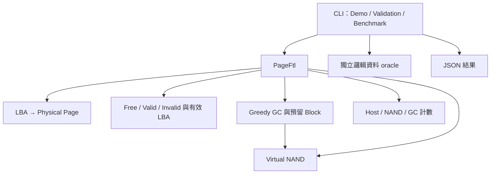

# MiniSSD MVP 架構與合約

FTL 擁有 NAND；唯讀診斷可觀察資料與 metadata，避免外部繞過映射修改底層。
`nand-demo` 使用獨立 NAND；`ftl-demo` 選擇 `GcMode::Disabled`，展示停用回收時的空間耗盡行為。

## 模組

| 檔案 | 責任 |
|---|---|
| nand_flash.hpp / cpp | 記憶體內 NAND、位址與大小檢查、Program／Erase 限制、一次故障注入 |
| ftl.hpp / cpp | LBA 映射、異地更新、Trim、GC、預留管理、錯誤回復與操作統計 |
| workloads.hpp / cpp | 獨立 oracle、完整驗證、模擬 Benchmark、JSON 編碼 |
| main.cpp | 命令列解析、Demo、執行工作負載、輸出報告 |
| tests/ | NAND／停用 GC 的 FTL／GC 與故障情境 |
| build.ps1 / CMakeLists.txt | 建置與測試 |

## NAND 合約

位址從 0 起；一頁一次讀／寫，一個 Block 一次抹除。
新建／Erase 為 FF；每個頁每個 Erase 週期只能成功 Program 一次。
錯誤大小、越界、重複 Program 的返回錯誤不改變 bytes。
Read 複製一整頁，返回錯誤時 output 不變。
Erase 計數追蹤成功操作，抹除已空 Block 也計數。

故障注入只消耗原本合法的 Read／Program／Erase，發生在操作改變資料之前。
每種操作可指定跳過 N 次，再失敗一次。這不是部分硬體寫入或掉電模型。

## FTL 合約

| 介面 | 行為 |
|---|---|
| write(lba, data) | 驗證輸入、必要時 GC、Program 新頁、切換映射、舊頁失效 |
| read(lba, output) | 查表讀最新資料；非法／未寫入／Trim 後返回錯誤 |
| trim(lba) | 移除映射，原頁 Invalid；重複 Trim 成功 |
| collect_garbage() | 清理未完成暫存、選最多 Invalid 的 victim、搬移、切換映射、抹除、交換預留區 |
| physical_address(lba) | 映射的唯讀值；非法／未寫入返回 nullopt |
| page_info(address) | 狀態與有效 LBA 的副本 |
| stats() | 全實體頁 Free／Valid／Invalid，包含預留區 |
| available_free_pages() | 可供 Host 使用的空頁，不含預留區 |
| metrics() | 累計成功 Host 寫入、NAND Program／Erase、GC、Trim 等 |
| inject_failure() | 測試專用：設定操作前一次故障 |

自動 GC 要求至少兩個 Block，且 0 < logical_pages < (block_count - 1) × pages_per_block。
停用 GC 只要求 0 < logical_pages < total_pages；用於測試與展示空間耗盡情境。
一個 model LBA 等於一個完整 NAND Page，不實作 sector 合併、拆分。

寫入返回錯誤時，原邏輯內容保留；若 GC 已成功，原實體映射可能已改變。
建構、記憶體配置、檔案報告錯誤仍使用標準 C++ 例外，CLI 返回非零退出碼。

## GC 資料不變條件

- 每個映射指向一個 Valid Page，保存最新成功寫入的資料。
- 每個 Valid Page 的 LBA 和映射表相符，沒有兩個 LBA 共用有效頁。
- Free／Invalid 沒有有效 LBA。
- 預留 Block 沒有對 Host 發布的 Valid 頁；清理失敗可留 unmapped Invalid 暫存頁。
- Free + Valid + Invalid = 實體頁數。
- GC 成功只改位置，不改邏輯資料；原 victim 成為已抹除的新預留 Block。
- 失敗清理的預留區會先重試清理，未清理前不供 Host 使用。

## 複雜度與取捨

映射查找 O(1)，頁資料複製 O(Page 大小)。
空頁搜尋及頁統計 O(實體頁數)；Greedy 選 victim 掃描全部頁。
GC 記憶體最多暫存一個 Block 的有效資料。

MVP 優先選擇可檢查的行為與清楚的錯誤路徑。
尚未設計高效能索引、冷熱分離、磨耗平均、非同步或多執行緒配置。

## 範圍

本機已驗證 Windows g++ 與 CMake/Ninja。
GitHub Actions 已配置 Windows／Linux 和 Linux sanitizer，但尚未執行遠端 CI。
本模型沒有持久化、掉電恢復、ECC、壞塊、真實 NAND／NVMe 命令或硬體存取。
